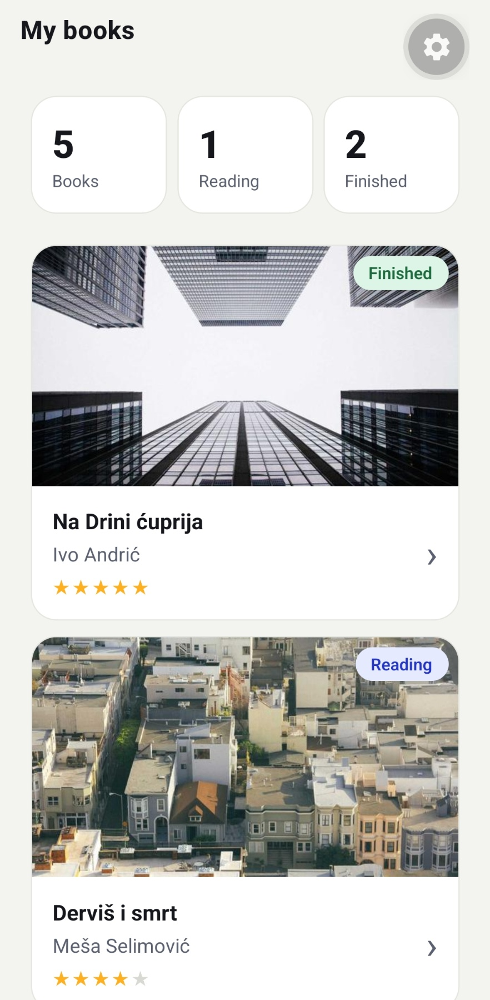
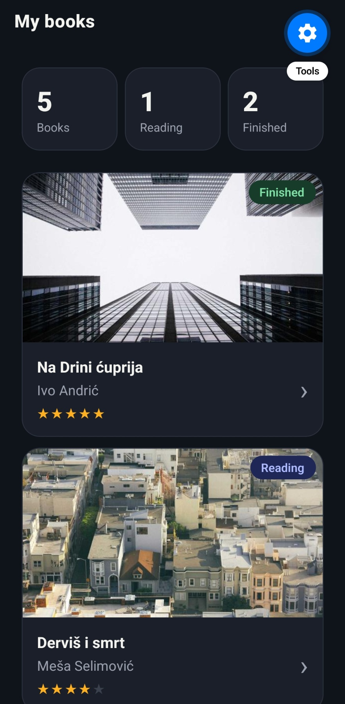

# Next Chapter

Next Chapter is a personal reading list where users save books they want to read, are reading, or have finished.
<br>
Each book can have a rating, a short note and a cover photo taken from the camera or gallery.

## Run the project

```bash
npm install
npx expo start
```

## Features

- [x] List of books (mock data)
- [x] Status filter
- [ ] Book details screen
- [ ] Add and edit a book
- [ ] Cover photo from the camera or gallery
- [ ] Login
- [ ] Tabs for Books and Profile
- [x] Sort order
- [ ] Extras: search, reading statistics
- [x] Light and dark theme, layout for phones and tablets
- [x] Loading and error states, pull to refresh, long press to delete

## Screenshots

| Light mode                                 | Dark mode                                |
| ------------------------------------------ | ---------------------------------------- |
|  |  |
